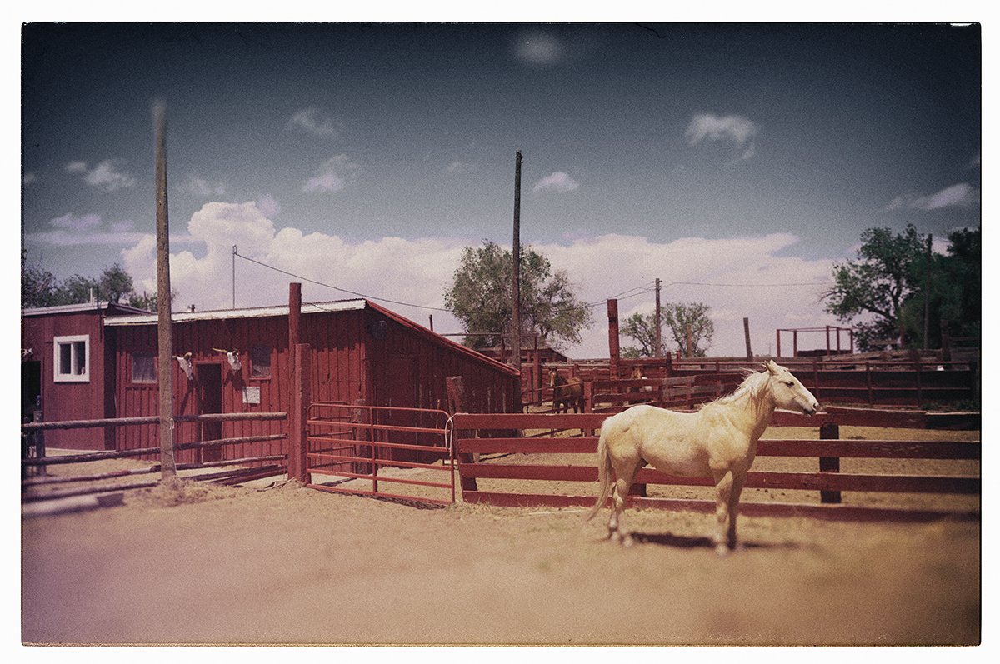

Door Herman van der Horst

Vanuit het groen langs de highway rijst een reusachtig bord op met de letters: Hell Is Real. Om de een of andere reden rijst bij ons het vermoeden dat we nu in Kentucky zijn beland. En jawel, spoedig verschijnen de torens van de hoofdstad Louisville, dat hier uitgesproken wordt als láú-áúwville. Zonder een spoortje onthaasting neergevleid in een bocht van de Ohio River. De stad van de Kentucky Derby, van Colonel Sanders’ Kentucky Fried Chicken, van Muhammed Ali en van de enigmatische singer-songschrijver Will Oldham alias Bonnie Prince Billy, die er nog steeds woont.

Nashville heeft zijn Music Row, Louisville kan bogen op zijn historische Whiskey Row, de lommerrijke Main Street waarlangs het hart van Kentucky’s bourbon industrie is gevestigd. Bourbon is van oudsher zoiets als Kentucky’s huisdrank. Liefhebbers kunnen de stad en de staat verkennen via de Bourbon Trail die langs ontelbare bars en stokerijen voert. Wij bepreken ons tot de bourbon stokerij van het merk Evan Williams, vernoemt naar de eerste distilateur van Kentucky. Daar leren en vooral proeven we dat bourbon meer is dan een Amerikaanse whiskey variant. Even verderop, in de Hay Market Whiskey Bar, een sfeervol drankhol met meer dan 75 soorten bourbon achter de tap, speelt een akoestisch kwartet toepasselijk Into The Mystic.

Broodnuchter zetten we de volgende ochtend koers naar de schitterende Renfro Valley in Madison County. Hier op het platteland vind je ze nog overal: rode boerenschuren waar men iedere zaterdagavond danst op old time- en bluegrass muziek. De muzikanten spelen til the cows come home…zoals ze dat hier zeggen. Toevallig is het geen zaterdag, dus hebben we weer eens pech. Maar wij hadden ons prima thuisgevoeld tussen een publiek dat bestaat uit Kentucky Colonels, fiddlers, mechaniciens, mijnwerkers, boeren, buren, de kinderen van de buren en veel mannen die Hoss heten.

Berea is een ruimdenkende oase in een conservatieve staat. Kunst, educatie en duurzaamheid vormen de pijlers van dit idylische plaatsje. Sinds het einde van de 19-de eeuw bloeit Berea als een centrum van Appalachen kunst en –ambacht, getuige de talloze galleries, werkplaatsen en winkels. Waaronder het zaakje van meubelmaker Warren A. May, die er al veertig jaar zijn dulcimers bouwt.

Het Berea College was de eerste zuidelijke universiteit die blanke en zwarte studenten uit alle millieus toeliet. In de jaren zestig introduceerde Lewis Lamb, een fiddler uit het nabij gelegen dorpje Paint Lick, de traditionele Appalachen muziek op de tennisbaan van de universiteit. Spoedig bijgestaan door zijn dochter Donna, die haar eerste gitaar verdiende met het pellen van tabak. Inmiddels reizen ze de halve wereld over en is hun old time muziek hipper dan ooit, vooral onder jonge muzikanten.

In het Appalachen gebergte liggen de diepste wortels van alle Amerikaanse country muziek. Van oorsprong Engelse, Schotse en Ierse ballades, die door de straatarme bergbewoners zijn geëvolueert tot unieke Amerikaanse folkmuziek, om hun harde en verwarrende bestaan een betekenis te geven. Deze grimmige en niet zelden haast surrealistische songs – op platen gezet in de jaren twintig en dertig – zijn door auteur Greil Marcus omschreven als ‘het oude, vreemde Amerika.’

Lewis en Donna Lamb zien eruit alsof ze zo van de tractor zijn gestapt en dat blijkt ook zo te zijn. Al draagt Tewis een honkbalpet met de tekst: I’ve been horsing through Kentucky.’ De toenemende populariteit van old time muziek heeft volgens Donna te maken met de huidige recessie. ‘Mensen hebben niet meer het geld om naar Disneyland te gaan’, legt ze uit. ‘Dus zoeken ze het dichter bij huis en ontdekken hun eigen roots: muziek die ze nooit eerder hebben gehoord.’

Even later klinkt hun strenge Appalachen-folk tegen de wind op een veranda in Berea. Als Donna’s doordringende bergstem een murderballad inzet, lijkt het alsof het oude, vreemde Amerika weer terug is in Renfro Valley.

Kentucky wordt de Blue Grass State genoemt, omdat het gras er soms een blauwachtige kleur kan hebben. Maar als wij uit Lexington vertrekken, is alles buiten het autoraam diepgroen en goudbruin. Paarden kijken verbaast op vanuit glooiende weiden, omzoomt door bosbessenstruiken en gombomen. Niet zo hoog in de vroege avondlucht staat een bleke maan, die met een beetje verbeelding wel blauw zou kunnen lijken. We zijn op zoek naar de geest van de man die Blue Moon Of Kentucky schreef: Bill Monroe, the Father of Bluegrass Music.  
Ter voorbereiding zingen we in de auto mee met I’m On My Way To The Old Home, de song die Monroe schreef over ‘the fondest spot in my memory’, het kleine lichtgrijze huis aan de rand van het plaatsje Rosine, waar hij werd geboren langs een bochtige weg ‘high up in the hills of old Kentucky.

Bluegrass is een vorm van traditionale akoestische string muziek, die nog steeds ongeveer zo klinkt als in de jaren veertig, toen muzikanten als Monroe en Ralph Stanley het uit de veranda’s tilden en het over het land begonnen te spelen. Hoge en hard indringende stemmen worden omlijst door een instrumentatie die meestal beperkt blijft tot banjo, fiddle, mandoline, gitaar, bas en dobro. Bluegrass legt de nadruk op virtuositeit en een syncopatie die geïnspireert is door zwarte dansmuziek. De muzikanten spelen solo breaks, zoals jazzmuzikanten dat doen, en bluegrass liefhebbers kunnen Earl Scruggs’ banjo net zo makkelijk onderscheiden van Don Reno’s als jazzfanaten je kunnen vertellen dat het Lester Young is die de sax blaast en niet Zoot Sims.

Zijn ‘hillbilly versie van jazz’, zo mocht Bill Monroe het graag aanduiden. Hij nam de old time mountain muziek en maakte er iets nieuws van. Hij was een kleerkast – een meter negentig en 200 pond schoon aan de haak – die zong als een weemoedig vogeltje. Een watervlugge meester op zijn Gibson mandoline, die de shimmy danste met een mengeling van kracht en elan.

Monroe was zo’n competitieve man, dat als hij de hand schudde met iemand op straat, dit steevast ontaardde in touwtrekkerij. Een gewoonte die hij voorbehield aan mannen. Bij vrouwen had hij een andere methode. Hij hield ervan om ze te laten horen dat hij hoger kon zingen dan zij. Zijn zwijgzaamheid was berucht. Chet Atkins vertelde graag de anekdote over de noordelijke musicoloog van een prestigieuze universiteit die naar het zuiden reisde om Monroe te ontmoeten. Hij zei dat hij een boek over bluegrass ging schrijven. Hij vertelde Bill over de Andes, over Ierland en over Egypte. Legde hem uit wat de muziek van over de hele wereld met bluegrass te maken had. Daarop vroeg hij Bill waar bluegrass vandaan kwam. Bill zei: ‘Down home.’ Kort interview.

Ondertussen hebben wij de highway verruilt voor zandwegen. We rijden door Hartford, dat bezoekers begroet met een bord waarop staat: ‘Welcome to Hartford Kentucky Home of 2000 Happy People & a Few Soreheads.’ Het bord voor Rosine is even gemoedelijk: ‘Hi There. Welcome to Rosine – Home of Bluesgrass Music’, en het plaatsje is net zo nonchalant over zijn populatie. De beste schatting die iedereen je kan geven is dat er tussen de 100 en 200 boeren en mijn werkers wonen.

Om het huis te bereiken moet je een paar korenvelden passeren, een voormalig korenveld dat nu een bovengrondse mijn is, een spoorweg oversteken en een bochtige weg omhoog rijden voorbij het bordje ‘Coon Hunt’ naar een hek voor de ingang van een pad door het bos.

Het pad is bezaaid met diepe waterpoelen waaruit kikkers voor onze voeten springen. Een paar verschrikt kijkende herten willen de weg oversteken, evenals een stel konijnen. Wanneer we uiteindelijk het huis bereiken, oogt het alsof het ook al een tijdje geen mensen heeft gezien.

Op deze godverlaten plek groeide Bill Monroe op als een halfblinde boerenjongen met pestende oudere broers en een zeer beperkte garderobe: elk jaar kreeg hij een paar schoenen en twee paar overalls.

Een stuk verder op de Jerusalem Ridge vinden we de al even eenzaam gelegen tweekamer hut van zijn oom James Pendleton Vandiver – Uncle Pen in Monroe’s song. Zijn moeder stierf toen Bill tien jaar was en nadat zes jaar later zijn vader was begraven, trok hij in bij zijn fiddle spelende oom Pen, die hem muziek leerde spelen. Recentelijk is de hut geheel herbouwt door zijn oudneef James Monroe.

Op de begraafplaats van Rosine liggen Bill Monroe (hij overleed 1996, vier dagen voor zijn 85-ste verjaardag) en het merendeel van zijn familie, inclusief Uncle Pen. Alsmede Arnold Schulz, de zwarte vrachtrijder en bluesgitarist die Monroe ontmoette tijdens een dansavond in Rosine. Het was via Schulz dat Monroe, het produkt van een geïsoleerde plattelands gemeenschap, voor het eerst werd blootgesteld aan de buitenwereld en de exotische en gesyncopeerde licks die zijn muziek deden uitstijgen boven lokaal entertainment.

Nadat hij vier jaar met zijn broer Charlie had gezongen, formeerde Monroe The Bluegrass Boys in 1939. Maar hun muziek werd pas echt bluegrass, zoals we die nu nog kennen, toen eind 1945 banjospeler David ‘Stringbean’ Akeman werd vervangen door de 21-jarige Earl Scruggs. De zoon van een pachtboer uit North-Carolina, die werkte als hulpje in een katoenspinnerij en zichzelf s’avonds banjo had leren spelen zoals niemand dat ooit had gedaan. Scruggs begon de vijfsnarige banjo met drie vingers te spelen. Zo wekte hij de indruk met een duizelingwekkende snelheid over de snaren te razen. In Monroe’s band werd hij geïntroduceerd als ‘the boy who can make the banjo talk.’

Scruggs groeide uit tot de vaderfiguur voor alle banjospelers. Het is onmogelijk om bluegrass te spelen zonder Earl Scruggs te leren. In 1948 verlieten Scruggs en gitarist Lester Flatt de band van Monroe om een eigen groep te beginnen. Zij waren niet de enigen. Als werkgever was Monroe een ongelikte beer; zijn tourschema’s waren moordend en zijn lonen laag. Maar hij drilde generaties fiddlers en banjospelers tot vlijmscherpe perfectie.

Tot op de huidige dag worden zijn Bluegrass Boys, Flatt & Scruggs’ Foggy Mountain Boys en The Stanley Brothers beschouwd als de onwrikbare pijlers van de bluegrass. Deze geweldige muzikanten waren eenvoudige werklieden – mijnwerkers, boeren, fabriekshulpjes – en zij hadden werklieden in gedachten wanneer ze hun muziek maakten. Maar hun songs spraken tot allerlei soorten Amerikanen, van New Yorkers die hun Carnegie Hall concerten uitverkochten tot de Tennessee boer genaamd Poodler die twintig mijl op een ezel reed om ze te zien spelen. Over de muziek van Bill en Charlie Monroe zei Bob Dylan ooit: ‘Dit is voor mij de kern van Amerika.’

Rijdend door de eenzame heuvels van de Jerusalem Ridge beseffen we dat zulke weemoedig kokende country jazz alleen ontwikkeld kon worden door een zwijgzame bullebak die opgroeide met het geblaf van de jachthonden in de Kentucky schemering.

‘Zijn muziek brengt me terug naar mijn jeugd’, vertelde Francis Harvey, een ver familielid, in de hut van Uncle Pen. ‘Soms wens ik dat ik naar die tijd kan terugkeren. Maar, weet je, er bestaat goed treurig en slecht treurig. Monroe’s muziek is goed treurig.’

We eindigen onze reis door Kentucky in Owensboro, een stadje waar het inwonersaantal gelijk moet zijn aan het aantal kerken. Die avond in het Smothers Park langs de Ohio River spelen drie jonge lokale helden een mengeling van bluegrass, gospel en countryklassiekers. De maan die in het donkere water van de rivier spiegelt, is nu volmaakt blauw.
