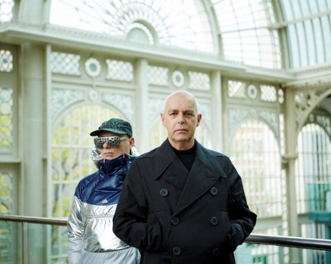

Super is de titel van het nieuwe album van Pet Shop Boys dat op 1 april uitkomt. Het album werd geschreven in Londen en Berlijn en in Los Angeles geproduceerd en gemixt door Stuart Price. Super telt twaalf nieuwe Tennant/Lowe composities waaronder de eerste single The Pop Kids, een klassiek Pet Shop Boys nummer dat herinneringen oproept aan de Londense club-scène van begin jaren ’90. Super is de opvolger van het in 2013 verschenen Electric waarmee PSB haar hoogste chart entry in twintig jaar haalde in Amerika en Engeland.

Onder de noemer Inner Sanctum geeft Pet Shop Boys van 20 tot en met 23 juli vier bijzondere concerten in het Royal Opera House in Londen. De show is ontworpen door Es Devlin, die al heel lang met het tweetal werkt, en choreograaf Lynne Page. Dit zijn de enige shows dit jaar in Engeland. Over concerten op het vaste land van Europa is op dit moment nog niets bekend.

In een verklaring zegt Pet Shop Boys: “It was fantastic to be back in the studio with Stuart Price continuing from where we left off with ‘Electric’ and we’re thrilled with the results. It’s also very exciting to take electronic music into the Royal Opera House – such a grand and beautiful venue. These will be four very special nights for us and our only UK concerts this year.”

<iframe src="https://www.youtube-nocookie.com/embed/Omqby5MqDjs" title="Video" loading="lazy" allowfullscreen=""></iframe>

