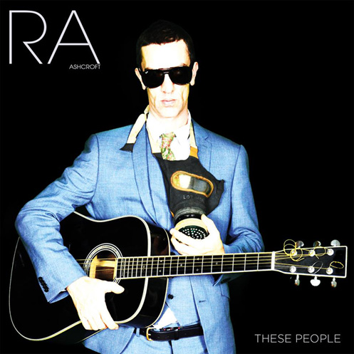
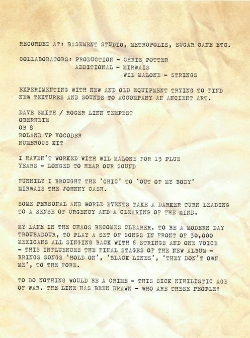

Richard Ashcroft keert op 20 mei terug met zijn vierde soloalbum These People, dat wordt uitgebracht op zijn nieuwe Righteous Phonographic Association label in samenwerking met Cooking Vinyl. These People, het eerste album van Richard Ashcroft in zes jaar, is opgenomen in Londen en werd door Richard samen met Chris Potter, zijn samenwerkingspartner van het eerste uur, geproduceerd. De opnamen betekenden ook een weerzien met Wil Malone, die met Richard de strijkersarrangementen maakte voor The Verve-albums A Northern Soul (1995) en Urban Hymns (1997) en zijn solodebuut Alone with Everybody uit 2000.

Gezegend met een van de meest unieke en onvergetelijke stemmen uit de moderne Britse popmuziek is These People een karakteristiek Richard Ashcroft album, maar heeft hij ditmaal ook avontuurlijke nieuwe geluiden, texturen en thema’s verkend.  
These People is de herbevestiging dat Richard Ashcroft, die in zijn rijke carrière al een Brit en Ivor Novello Award won en genomineerd werd voor een Grammy Award, een van de meest bepalende en wonderbaarlijkste songwriters van zijn generatie is.  
Eind 2015 deed Richard Ashcroft een handvol onaangekondigde akoestische concerten in Zurich en Bilbao en stond hij in november solo voor 30.000 mensen tijdens het Corona Capital Festival in Mexico.

Over zijn nieuwe album zegt Richard:

Luister hier naar de eerste single This Is How It Feels:

<iframe src="https://www.youtube-nocookie.com/embed/kzuYdRfdjls" title="Video" loading="lazy" allowfullscreen=""></iframe>

