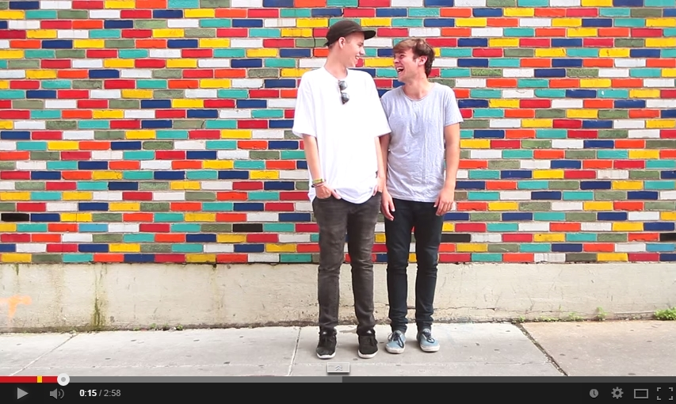

**Mooi nieuws! Vanochtend is bekend gemaakt dat** [Emil Landman is genomineerd](http://v2benelux.us8.list-manage1.com/track/click?u=72e667599b8977675707ba570&id=116d885a6d&e=faaee166ae) **voor de Edison Award Beste Nieuwkomer 2015.**

De Edison is een van de oudste muziekprijzen in de wereld. Alleen de Amerikaanse Grammy is 1 jaar ouder dan de Nederlandse Edison. Naar het voorbeeld van de Grammy (die in 1957 is verzonnen en in 1959 voor het eerst werd uitgereikt) werd door de toenmalige Nederlandse Commissie Collectieve Grammofoonplaten Campagne (CCGC) de Edison ingesteld als “een jaarprijs voor artiesten, die met hun platenoeuvre van dat jaar de beste prestatie – naar het oordeel van jury – in hun genre gegeven hebben”.  
Emil is genomineerd voor zijn debuutalbum ‘Colours And Their Things’, waarvan de eerste single ‘Goodnight, New Orleans’ afkomstig is:

Vorig jaar wonnen Mister and Mississippi de prijs voor [Best Alternative 2014](http://v2benelux.us8.list-manage2.com/track/click?u=72e667599b8977675707ba570&id=721c2fb371&e=faaee166ae), we hopen uiteraard dat Emil op 2 maart het felbegeerde beeldje mee naar huis mag nemen.

Emil zal ook te zien zijn tijdens [3FM Serious Talent On Tour](http://v2benelux.us8.list-manage.com/track/click?u=72e667599b8977675707ba570&id=cd23ac18b6&e=faaee166ae):

24 april – Tivoli De Helling  
25 april – Hedon, Zwolle  
7 mei – Effenaar, Eindhoven  
8 mei – Paradiso, Amsterdam  
13 mei – Metropool, Hengelo  
14 mei – Patronaat, Haarlem  
16 mei – Rotown, Rotterdam  
29 mei – Doornroosje, Nijmegen  
30 mei – Paard van Troje, Den Haag
