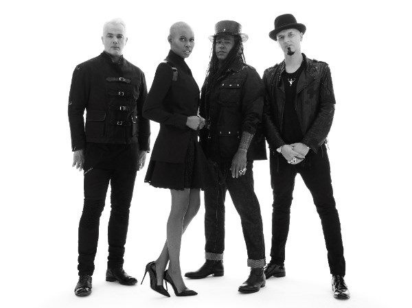

Skunk Anansie is terug met het zesde studioalbum Anarchytecture, een collectie stevige alternatieve rocknummers boordevol krachtige riffs en vuur zoals dat alleen uit het hart en de ziel van voorvrouw Skin kan komen. Naast Skin bestaat Skunk Anansie uit gitarist Ace, bassist Cass en drummer Mark Richardson.

Anarchytecture is de opvolger van het in 2012 verschenen Black Traffic en werd met producer Tom Dalgety (o.a. Royal Blood, The Maccabees, Killing Joke) opgenomen in de RAK studios in Londen. Samen met Jeremy Wheatley mixte hij ook het album, terwijl Ted Jensen in de Sterling Sound in New York de mastering verzorgde.

Naar aanleiding van Anarchytecture tourt Skunk Anansie in februari 2016 door Europa. Op maandag 8 februari staat Skunk Anansie in Paradiso, Amsterdam.

Skin is momenteel jurylid bij de Italiaanse X Factor, waarvoor ze speciaal Italiaans leerde, en staat deze maand op de cover van de Vanity Fair Italië.

Skunk Anansie werd in 1994 opgericht, stopte in 2001 en blies de band in 2009 nieuw leven in. De groep bracht vijf studioalbums uit – Paranoid and Sunburnt (1995), Stoosh (1996), Post Orgasmic Chill (1999), Wonderlustre (2010) en Black Traffic (2012) – en releaste in 2009 het compilatiealbum Smashes and Trashes en in 2013 het akoestische live album An Acoustic Skunk Anansie – Live In London. De band scoorde grote hits met Charity, Hedonism, Brazen (weep), Selling Jesus, I Can Dream en Weak en groeide in de jaren ’90 uit tot een van de grootste rockbands in Engeland en Europa. Skunk Anansie verkocht meer dan vijf miljoen albums en deed tussen 1994 en 2000 zeven uitverkochte wereldtournees.
