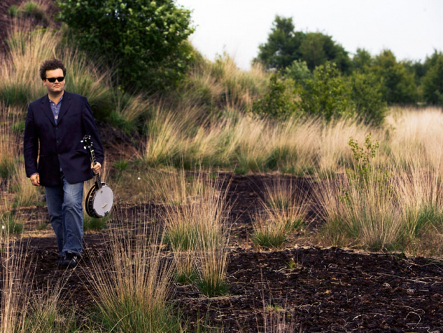

Drent en wereldburger Daniel Lohues zal tegen de 50 lopen en kan als hij zou willen met opgeheven hoofd terug kunnen kijken op zijn carrière… Poeh, wat heeft de man al een cd’s geproduceerd en natuurlijk niet alleen voor hem zelf. Zo produceerde hij onder andere voor Rob de Nijs, Guus Meeuwis en Jenny Arean. Ja, die Lohues houdt er niet van om op zijn stoel voor de openhaard te zitten.

Skik, Lohues zijn oude bandje, hoorde ik voor het eerst in 1994 toen met de hit ‘Op Fietse’. Het is nog steeds een plaat waar je vrolijk van wordt. Skik valt op, ook in Hilversum, en staat wekenlang in de moordlijst van Oor, ze staan onder andere op Pinkpop en gaan als een speer. Lohues besluit na een aantal prachtige jaren dat het tijd is voor wat anders en toen begon het prachtige solo-avontuur van Lohues echt.

Moet je een plattelander, een Drent of een Fries zijn om zijn liedjes te begrijpen? Nee, niet per se. Daniel kan je met zijn teksten precies in een sfeer brengen die voor weinig Nederlandstalige artiesten is weggelegd. Lohues schrijft in zijn ‘memmetaal’ zouden wij hier in Friesland zeggen, zo ook op zijn nieuwe album Sowieso.

Photo © Kees Tabak

Op de platen van Lohues sijpelt altijd wel ergens zijn katholieke, kerkelijke roots door en dat legt hem geen windeieren, integendeel. Het geeft letterlijk vaak veel verdieping en extra lagen in zijn liedjes, soms is het net of je zit te lezen in het dagboek van de man zelf.

De thema’s die voorbijkomen zijn heel universeel. Liefdes en verlangens die maar niet willen lukken, het platteland en mijmerend in het vuur kijken, alleen in je huis…Een soort eenzaamheid die we allemaal eerlijk waar wel kennen. Het eerste nummer van Sowieso kan gehoord worden als een liedje vol troost. Het gaat over de hemel, overlijden en elkaar terugzien. Op zich heeft Lohues daar een punt, maar aan de andere kant bezingt Daniel dat alles ooit voorbijgaat, zelfs de Hoover dam is op een dag aan de beurt.

Spreekt hij zichzelf dan tegen? Welnee, alweer een prachtig album.
