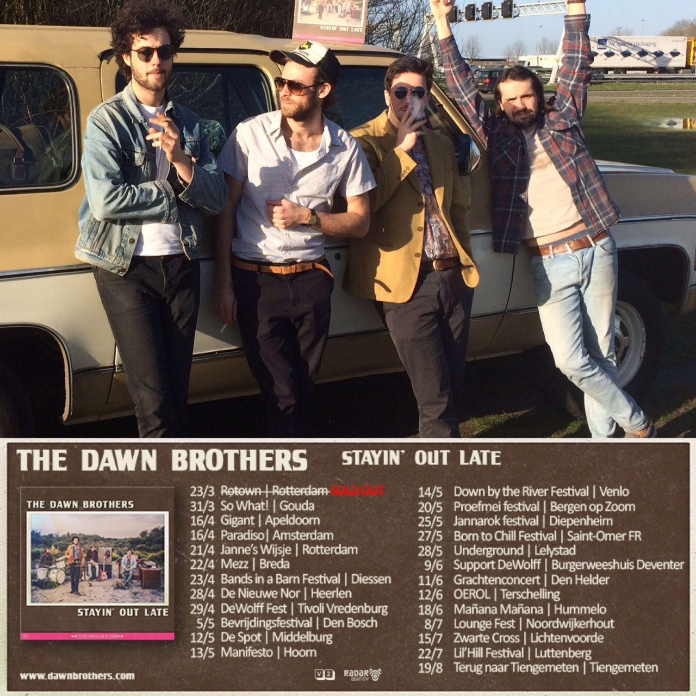

Het is tijd voor nieuwe rock ’n roll in een oud, versleten jasje. Luister vanaf vandaag overal naar Stayin’ Out Late, het bluesrock debuutalbum van The Dawn Brothers. Met dit album rijden The Dawn Brothers op een muzikale golf van het verleden naar de toekomst en leveren daarmee een overtuigend bewijs dat sexy, soulfull rock ’n roll altijd actueel zal zijn.

Deze jonge kliek vrije vogels laat zich inspireren door vertakkingen als blues, gospel en sixties rock. Impulsief jaagt de band de overtreffende trap na, met gouden melodieën als het onwrikbare fundament. De losgebarsten energie die vrijkomt, prikkelt en voedt de noodzaak om compléét uit je dak te gaan.  

<iframe src="https://www.youtube-nocookie.com/embed/kgdXc8qSH7A" title="Video" loading="lazy" allowfullscreen=""></iframe>

