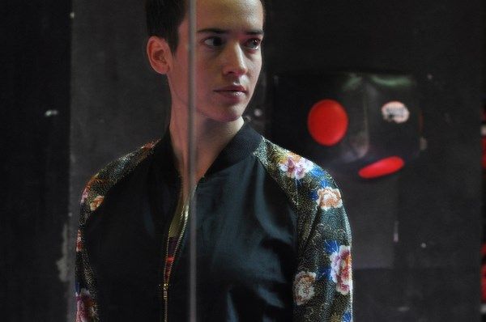

Op zondag 22 november verzorgt Stéphanie Blanchoud het voorprogramma van de Franse zanger Charles Aznavour in de Heineken Music Hall in Amsterdam. De uit Zwitserland afkomstige, in Brussel woonachtige Stéphanie Blanchoud deelde al eerder het podium met artiesten als Benabar, Yodelice, Jane Birkin, Juliette en Maurane. Laatstgenoemde nodigde haar uit voor de tournee met Nougaro waarmee in mei 2010 het Olympia in Parijs werd aangedaan.

Na een carrière als actrice besloot Stéphanie Blanchoud in 2004 zich volledig op de muziek te storten. Haar eerste album Insomnies verscheen in 2009 en werd opgenomen met Jean-François Assy, de violist van Alain Bashung. In maart van dit jaar verscheen de opvolger Les Beaux dat zowel Franstalige als Engelstalige nummers bevat. De Engelstalige nummers werden met producer Robert Carranze (Jack Johnson) in Los Angeles opgenomen, de overige opnames vonden plaats in Brussel. Les Beaux laat een prachtige mix van folk en pop horen waarin de echo’s van Natalie Merchant en T Bone Burnett doorklinken. Stéphanie speelde recent in Les Trois Baudets in Parijs en verzorgde in oktober 2014 het voorprogramma van Adam Cohen in de Botanique in Brussel.

Het bloed kruipt waar het niet gaan kan en dus heeft Stéphanie Blanchoud ook haar acteerwerk weer opgepakt. Op dit moment is ze naast Olivier Bonjour te zien in de nieuwe spraakmakende televisieserie Ennemi Public, die is geregisseerd door Matthieu Frances en Gary Sehgers. De serie gaat over Guy Maréchal, een notoir pedofiel en recidivist die door de bevolking dood wordt gewenst; een duidelijke verwijzing naar Dutroux. Deze staatsvijand nummer één staat op het punt te worden vrijgelaten. Stéphanie Blanchoud speelt de rol van Chloé, een jonge politie-inspecteur die wordt belast met het sombere en complexe onderzoek. Geconfronteerd met een bevolking die het recht in eigen hand wil nemen en een abdij die wel erg ver wil gaan om haar reputatie intact te houden, moeten Lucas en Chloé de krachten bundelen om de orde te handhaven en de harde waarheid te achterhalen.

<iframe src="https://www.youtube-nocookie.com/embed/6HId9FWKEm4" title="Video" loading="lazy" allowfullscreen=""></iframe>

<iframe src="https://www.youtube-nocookie.com/embed/Dy_zOM006MU" title="Video" loading="lazy" allowfullscreen=""></iframe>

