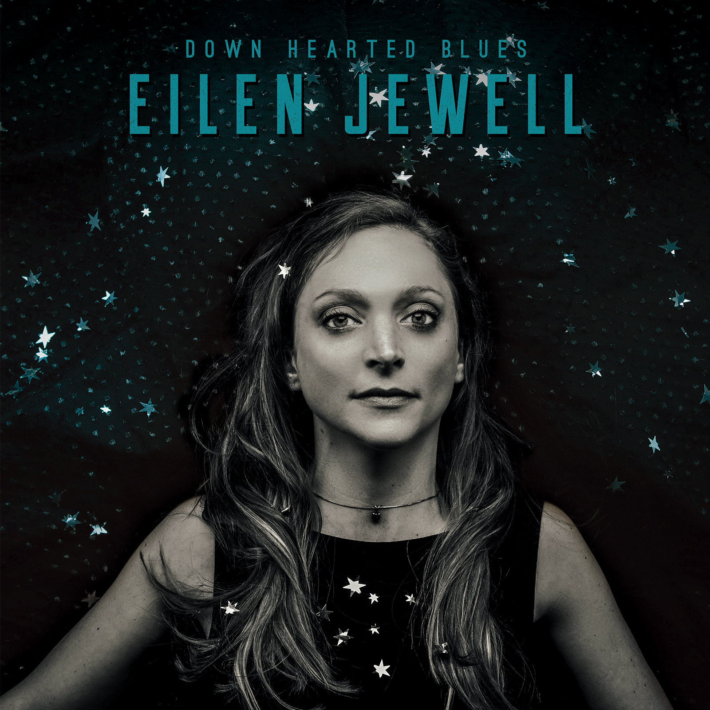

# Het nieuwe album Down Hearted Blues verschijnt op 22 september.

Op 22 september aanstaande verschijnt Down Hearted Blues, het nieuwe album van alt country zangeres Eilen Jewell. Down Hearted Blues bevat twaalf blues covers van onder meer Charles Sheffield, Willie Dixon en Albert Washington en verschijnt via Signature Sound Recordings.  
”We houden ervan om het verleden opnieuw naar boven te halen. Het voelt een beetje als graven naar diep verborgen schatten”, aldus Jewell. “Dit is precies waar muziek om draait. Ik hou van diverse soorten muziek, zolang het maar vintage klinkt.” Voor haar nieuwe album Down Hearted Blues werkte ze samen met haar partner en drummer Jason Beek aan klassiekers uit het verleden, geschreven of vertolkt door bekende en minder bekende artiesten. Van Willie Dixon en Memphis Minnie tot Charles Sheffield en Betty James. Met vernieuwende arrangementen blaast het duo nieuw leven in deze parels uit het verleden.

Eilen Jewell staat bij het grote publiek bekend om haar door country doordrenkte, doch moderne, folk waarbij zelfs een vleugje rockabilly en surf te horen is. Jewell’s discografie bevat vijf studio albums met eigen werk, een live album en een volledig Loretta Lynn cover album. Daarnaast heeft ze twee albums opgenomen met haar gospel groep The Sacred Shakers. Het nieuwe album, waarop Jewell en Beek samen de productie voor hun rekening namen en samenwerkte met pianist Steve Fulton en banjo speler Pat Storey, is haar eerste uitstapje naar de blues.”Het album voelt als een toevallige ontmoeting, maar wel een die voorbestemd was”, aldus Jewell. “Ik heb mezelf eindelijk toestemming gegeven om te doen wat ik graag wilde, en het universum heeft me gesteund tijdens de opnamen van het album!” Down Hearted Blues van Eilen Jewell verschijnt op 22 september via Signature Sound Recordings. Eilen Jewell is op 1 en 2 november te zien in Luxor Live (Arnem) en Patronaat (Haarlem).
