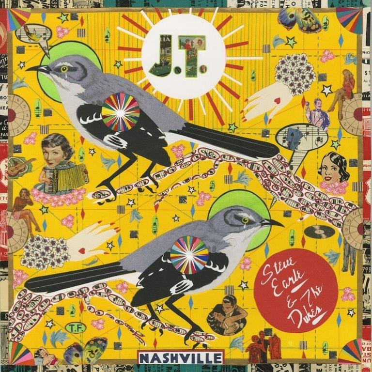

“Ik hield meer van Justin Townes Earle dan van wie of wat ook op deze wereld.” Een uitspraak van vader Steve Earle. Justin Townes Earle stierf op 20 augustus 2020, 38 jaren jong, aan een noodlottige combinatie van alcohol, cocaïne en fentanyl. Zijn oeuvre omvatte 1 EP en 8 LP’s. De zwanenzang The Saint Of Lost Causes was zijn meesterwerk, de plaat waarop hij als muzikant en componist op gelijke hoogte kwam met zijn vader.

Steve Earle heeft, zoals hij eerder deed met Townes Van Zandt en Guy Clark, maar één manier om zijn liefde en bewondering voor iemand te uiten en dat is een plaat maken met composities van ‘zijn held’. En dus is er nu J.T., met tien nummers van Justin Townes Earle, fantastisch vertolkt door Steve Earle & The Dukes. Als elfde nummer is er het hartverscheurende Last Words, het muzikale afscheid van de vader aan de zoon.

De opbrengsten van de prachtplaat J.T. gaan naar Justin Townes Earle’s enige kind, de driejarige Etta.

