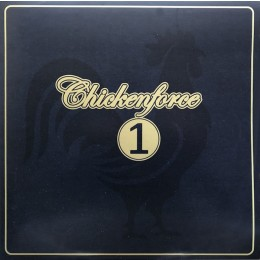

*Door Harry de Jong*

Tamme Oosterhof van Big Bad Wolf Records uit Leeuwarden heeft een bijzonder Fries bluesproject op elpee uitgebracht.

Het gaat om Chickenforce 1, een plaat waarop een dwarsdoorsnee van de rockscene uit deze provincie aan het werk is te horen. Maar liefst vijftien muzikanten zijn door initiatiefnemers Nico Outhuijse (De Kast), Rik Meijer en Gooitzen Greidanus opgetrommeld om een steentje bij te dragen. En dan hebben we het over onder andere Jack Bottleneck, Auke Busman (ex-Twarres), Minke Adema, Bas Kleine, Marieke Meijer en Ruben Mulder. Ook Fokke de Jong (ex-Normaal en King Of The World) is van de partij, al is hij dan geen ,oprechte Fries.’  Het resultaat bestaat uit een aantal smaakvol gekozen covers, met het accent op blues. Zo zijn er fraaie interpretaties te horen  van Ian Siegal’s Take A Walk In The Wilderness, de rockabilly klassieker I’m Left, You’re Right, She’s Gone en de gloedvolle souballad You Were Never Mine van Janiva Magness. Als een rode draad loopt het doorleefde gitaarspel van Rik Meijer door alle nummers.

De opnames vonden plaats in de Leeuwarder  Grien Room studio van Nico Outhuijse,  drummer van De Kast. Nico: ,,Ik heb vroeger met Rik Meijer en Gooitzen Greidanus in diverse bandjes gespeeld. Na 35 jaar kwamen we elkaar weer tegen en we vonden het hoog tijd om samen weer eens mooie muziek op te nemen. We nodigden vervolgens een aantal gastmuzikanten uit om mee te doen in de door ons gekozen nummers.’’

Als drummer van De Kast associeer je Nico niet direct met bluesmuziek. Toch heeft hij wel degelijk zijn roots in dit genre.  ,,Mijn ouders hadden een kroeg in Harlingen en daar was regelmatig livemuziek,’’ vertelt hij. ,,Het Piepke heette dat café en er was voornamelijk blues te horen, want daar was mijn vader helemaal gek van. Dat is dan ook het genre waarmee ik ben opgegroeid. Als klein jongetje mocht ik altijd even de eerste set beluisteren en daarna moest ik naar bed. Maar ik ging echt niet slapen, ik ging stiekem op de trap zitten en zo kon ik mooi de volgende sets horen. Ja, wie heb ik op die manier niet allemaal gehoord. De Blues Connection met Eelco Gelling bijvoorbeeld, een groep waar ik zelf later ook nog een blauwe maandag in  gespeeld heb.’’

**Platenlabel**

Tamme Oosterhof ging in 2012 van start met zijn platenlabel Big Bad Wolf Records en heeft inmiddels meer dan 60 elpees, cd’s en cassettes uitgebracht. Het gaat daarbij voornamelijk om metal en progrock. Bands die bij hem tekenden, komen zowel uit Europa als Amerika. Maar Oosterhof schuwt ook het experiment niet. Zo bracht hij enkele jaren geleden een opmerkelijk cd-drieluik uit van de in Leeuwarden wonende en uit Oostenrijk afkomstige professor en muzikant Elmar C. Fuchs. Experimentele pop, in geen enkel hokje te plaatsen. Maar wel bijzonder meeslepend.

**Alleen op elpee**

Chickenforce 1 is alleen op vinyl verkrijgbaar en de eerste bluesplaat die Oosterhof uitbrengt. ,,Zo zijn er altijd weer nieuwe uitdagingen,” vindt hij. ,,Ik sta nog elke dag open voor nieuwe dingen en zoek het avontuur in de muziek.”

Foto: Henk Bleeker
