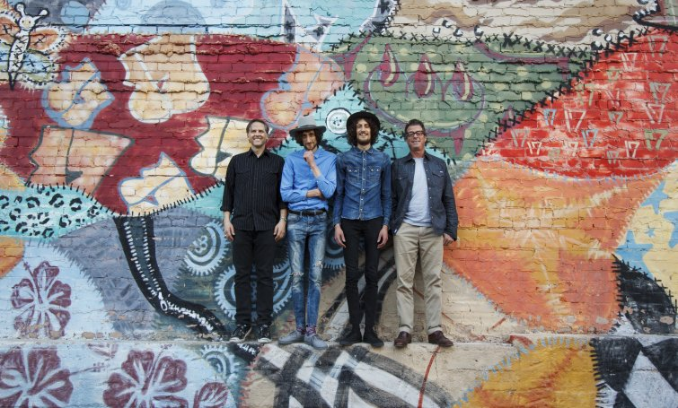

**Tangarine komt op 23 september met het nieuwe album There and Back. Opgenomen in de studio van Calexico, samen met John Convertino en Joey Burns, de oprichters van deze roemrijke Amerikaanse band. De tweeling zal het album presenteren op in TivoliVredenburg Utrecht op 8 oktober. Speciaal voor deze gelegenheid vormen de oprichters van Calexico, John en Joey deze avond de ritmesectie van Tangarine.**

Het afgelopen jaar zijn Sander en Arnout Brinks intensief met de twee Amerikanen opgetrokken. Na een aantal gezamenlijke optredens in Nederland reisde Tangarine af naar de Calexico-studio in Tucson, Arizona om daar samen met John en Joey There and Back op te nemen. Ook de sublieme geluidstechnicus Craig Schumacher (The Jayhawks, Calexico, Neko Case, Amos Lee) werkte aan het album mee.

Het gevolg hiervan is de beste muziek die Tangarine ooit maakte: bezielde folk en americana, gedrenkt in verwondering en melancholie. Inclusief close harmony, een smekende pedal steel, her en der wat strijkers, een heerlijk gedempt-droog drumgeluid, en nog steeds de opgetogen, ontwapenende sound die Tangarine typeert.

<iframe src="https://www.youtube-nocookie.com/embed/2NSz0E9pmNs" title="Video" loading="lazy" allowfullscreen=""></iframe>

