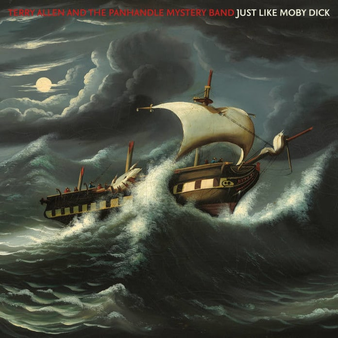
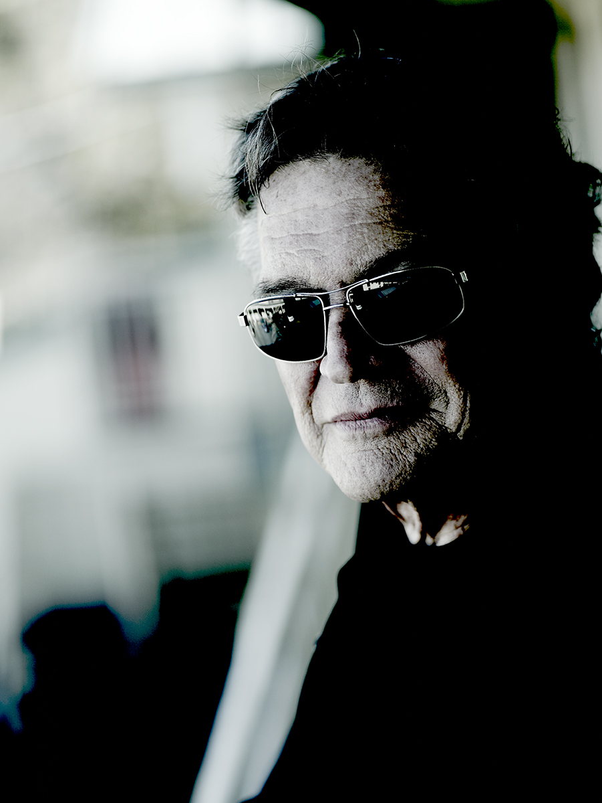

Texaan Terry Allen – Just Like Moby Dick

Allen stapt uit zijn Ford F150 pick-uptruck en vraagt: ‘How do I come up, guys ?’

Locatie: een sleezy motel in Austin voor een interview en een fotoshoot op de plek waar hij indertijd werkte aan het zwart omrande, maar wonderschone album Bottom of The World. Dat is best een poos geleden.

Terry Allen hoorde ik voor het eerst in de huiskamer bij popjournalist Harry de Jong, zo rond het jaar 1988 in Heerenveen. Ik was gelijk onder de indruk van deze Texaan met zijn zonderlinge stem die zong over mislukte liefdes, kunstenaarschap en Amerika.

Ik vertrek in een soortgelijke truck richting het zuiden van Argentinië, op zoek naar gauchos voor de Icons of the West-fotoserie waar ik al 20 jaar aan werk, dus nu Argentijnse cowboys.

De tijd on the road is niet te onderschatten; de afstanden in Argentinië zijn enorm en in mijn ogen wider en groter dan in Amerika. Het landschap glijdt aan mij voorbij, heel veel Amarillo highways, dus ik heb alle tijd om in de automaat te luisteren naar wederom een meesterwerk van mijn held.

Deze man kan je raken, maar waarom? Is Terry Allen de beste zanger, de beste schilder? Welnee, maar die “stem”… Hij neemt je mee in een sfeer die beklijft.  Terry schrijft liedjes als Abondonitus, een woord dat Terry Allen alleen maar kan bedenken. Dit krijgt een geheel eigen lading en gevoel op de vlaktes van Patagonië. Is het een state of mind? Ja, dat kan, nou zeker aldaar, en zo pakt Terry een uur lang door. Het album geeft iets bloot van totale desolaatheid in je hart en gevoel, zoals ook op nr 5  Pirate Jenny… Must be a storm in her heart sets her apart… Of in de tuin zitten met vrienden en de telefoon gaat en er is slecht nieuws, op Saillin’ On Through. Ja, die Terry is bijna 80 jaar en in de winter van zijn leven, maar misschien hoopt hij op een Houdini wonder… Dat klinkt hoopvol en zou misschien nog kunnen ook.

Jezus, wat een plaat. Een grote pluim.

Het album is perfect geproduceerd door Joe Ely, klinkt fantastisch. Soms denk ik als tweede stem bij Al These Blues Go Walking by Lucinda Williams te bespeuren, maar dat is niet waar. Zeker staat vast dat zoon Bukka op accordeon aanwezig is, net als oudgediende Loyd Maines.

Een tip van de Kultuurfabriek.

Photo © Henk Bleeker
