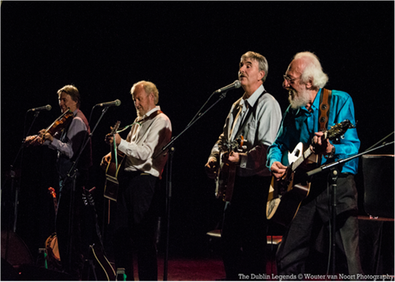

**Na de succesvolle tournee van vorig jaar komen The Dublin Legends, voorheen The Dubliners, opnieuw naar ons land voor een uitgebreide tournee. De groep zal tevens een drietal concerten geven in België. De tournee zal plaatsvinden vanaf 28 september tot en met 15 oktober. De kaartverkoop is inmiddels begonnen.**

Sommige bands zijn onsterfelijk. Toen John Sheahan, voorman van de fameuze Dubliners, in 2012 aankondigde te stoppen met de band, leek het doek definitief te zijn gevallen voor de meest legendarische Ierse folkgroep aller tijden. Maar de andere leden dachten daar anders over en gingen met veteranen Sean Cannon en Eamonn Campbell verder. Wel onder een nieuwe naam, want Sheahan nam de rechten op de bandnaam mee bij zijn vertrek. The Dublin Legends zetten de zegetocht van de grondleggers van de Ierse folk vol passie voort. In januari brachten The Dublin Legends hun nieuwe CD ‘Live in Vienna’ uit. Een zegen voor de immense schare fans die de Dubliners door de decennia heen met hun zinderende theatertours in ons land hebben opgebouwd. Namen verdwijnen, maar de legende blijft.  
Dublin Legends Sean Cannonn, Eamonn Campbell, Gerry O’Connor en Paul Watchorn weten hoe ze de harten van hun publiek moeten veroveren. Als iconen van het Ierse levenslied zingen ze vol overgave over drank, vrouwen, gelukkige en ongelukkige liefdes. De artiesten weten met hun enthousiasme een sfeertje te creëren dat je op slag doet vergeten dat je in een theaterzaal zit. Dit is de Ierse pub op zijn best, het kloppend hart van de Ierse dorpen en steden. In een avondvullend programma brengen ze een mix van oud en nieuw materiaal ten gehore, zoals ‘The wild rover’, ‘Dirty old town’, Whiskey in the jar’ en ‘The Irish rover’. Verrukkelijke folk-klassiekers, vertolkt door verrukkelijke rasartiesten.

Tourneelijst 2016  
28/9 Theater de Willem – Papendrecht, tel. 078-615 82 26; 29/9 De Roma – Antwerpen (B) tel. +32(0) 3 600 16 60; 30/9 Schouwburg Cuijk – Cuijk tel 0485 314344; 1/10 CCXL theater – Vlissingen, tel. 0900-2463 2489; 2/10 013 – Tilburg, tel. 0900-300 1250; 4/10 De Oosterpoort – Groningen, tel. 050-3680368; 5/10 TivoliVredenburg – Utrecht, tel. 030 – 2314544; 6/10 De Boerderij – Zoetermeer, tel. 079 – 321 10 12; 7/10 CC De Werf – Aalst, tel. +32 (0) 53 72 38 11; 8/10 De Maaspoort – Venlo, tel. 077-320 72 07; 9/10 De Metropool – Hengelo, tel. 074 243 80 00; 12/10 Magdalenazaal – Brussel (B) tel. +32 70 660 601; 13/10 Schouwburg Het Park – Hoorn, tel. 0229-291010; 14/10 Music Club – Kampen, tel. 038-3313826; 15/10 De Gigant – Apeldoorn, tel. 055 521 63 46
