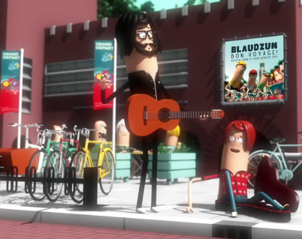
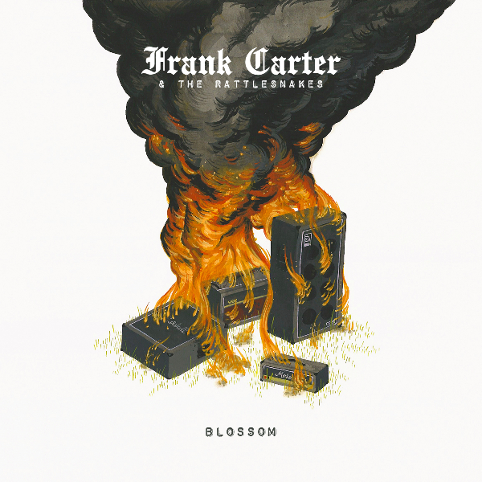
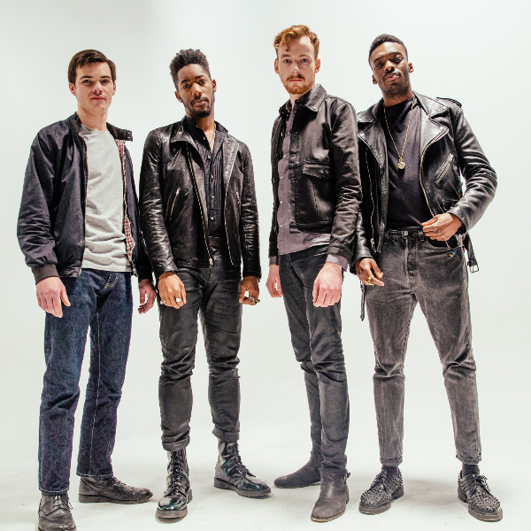
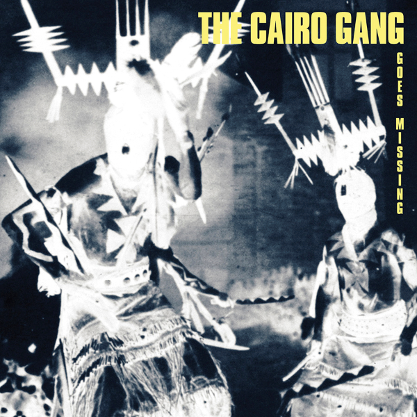
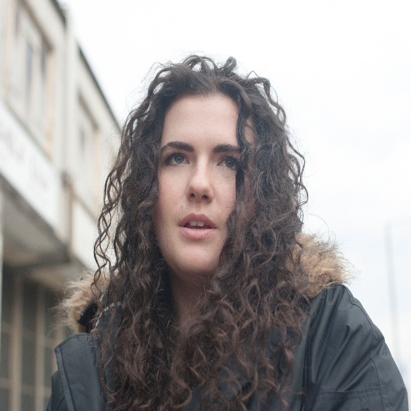
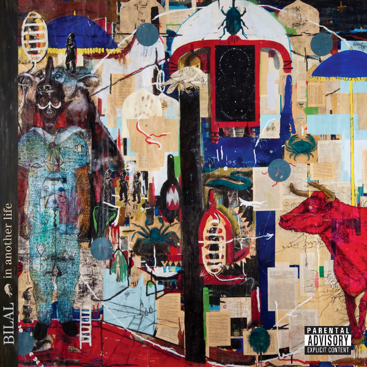
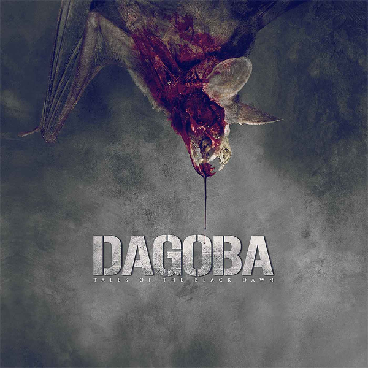
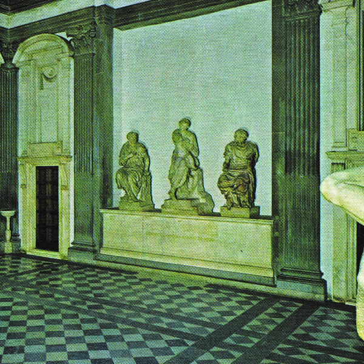
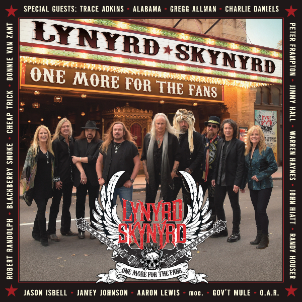

**Op donderdagavond 2 juli vindt vanaf 18:00 uur de ploegenpresentatie van de Tour de France plaats in Park Lepelenburg in Utrecht. Blaudzun, groot wielerliefhebber, schreef Bon Voyage, de officiële titlesong van Le Tour Utrecht en is een van de acts die de muzikale omlijsting van de ploegenpresentatie verzorgt. Om 20:30 uur zal Blaudzun aanvullend een gratis concert in Park Lepelenburg geven.**

## Nieuws

## Debuut Frank Carter & The Rattlesnakes

Op 28 augustus komt Frank Carter & The Rattlesnakes met het langverwachte debuut Blossom. Het album volgt op de EP Rotten die verleden maand werd uitgebracht. Geproduceerd door Thomas Mitchener en opgenomen in de Broadfields Studio verschijnt het tien nummers tellende Blossom op het eigen International Death Cult label in samenwerking met Kobalt Label Services. Lead track Fangs krijgt al de nodige airplay in de diverse rockshows op BBC Radio 1. Frank Carter was de oorspronkelijke zanger van de Britse hardcore-punkband Gallows.

## The Bohicas brengt debuut The Making Of uit

Met de aanstekelijk up tempo fuzz pop singles XXX/Swarm en To Die For gaf de Engelse formatie The Bohicas al een indrukwekkend visitekaartje af. Het debuutalbum van de labelgenoten van o.a. Arctic Monkeys en Franz Ferdinand bevat strakke garage rock met mersey beat pop sensibilty en glam rock bravoure. Beluister de nieuwe single Where You At. Het album The Making Of komt op 21 augustus uit via Domino Records. Dat zelfde weekend zijn The Bohicas ook live te zien op Lowlands.

## Nieuw album van The Cairo Gang

The Cairo Gang, de band van singer-songwriter Emmett Kelly, brengt op 3 juli het nieuwe album Goes Missing uit. Daar waar The Cairo Gang bij velen bekend staat om de prachtige tweede stem bij onder anderen Bonnie Prince Billy en Angel Olsen, laat zij op dit album horen een onvervalste power pop garageband te zijn. Goes Missing rolt van de ene gouden gitaarsong in de andere, geheel in traditie van Big Star, Teenage Fanclub en The Fab Four. Goes Missing is een verborgen meesterwerk, beluister hier alvast de nieuwe single Ice Fishing.

## Georgia brengt selftitled debuut uit

Na twee jaar van schrijven, opnemen en produceren komt de jonge producer, multi-instrumentalist en zangeres Georgia Barnes met haar gelijknamige debuut album, dat op Domino Records zal verschijnen. Het album Georgia is gevuld met een mix van vroege zero’s grime, West London ragga dub en HudMo-stijl beat, voorzien van een sterk gevoel voor sophisticated pop. Op Georgia hoor je het bravoure van de straat omlijst met gouden melodietjes. Bekijk hier de video bij de single Nothing Solutions.

## Bilal is terug met een nieuw ijzersterk album

In Another Life is het nieuwe album van Neo Soul zanger Bilal. De krachtige, down to earth, raw analogue, drums, fuzz bass productie komt van producer Adrian Younge. In Another Life ligt in het sociopolitical verlengde van het meest spraakmakende hip hop album van het jaar, To Pimp A Butterfly, van Kendrick Lamar waarop Bilal zijn stem leende voor de tracks Institutionalized en These Walls. Op In Another Life bedankt Kendrick Bilal op zijn beurt weer met guest vocals op het nummer Money Over Lover. Andere guest vocals worden verzorgt door onder anderen Big K.R.I.T. en future R&B zangeres Kimbra. De video bij de nieuwe track Satelites bekijk je hier.

## Concerten

**27/06** Mister and Mississippi | Rapalje Festival, Groningen  
**27/06** Janne Schra | Down The Rabbit Hole, Beuningen  
**27/06** Hanni El Khatib | Festival de Beschaving, Utrecht  
**27/06** Sunday Sun | Broedplaats, Weert  
**28/06** Blaudzun | Rock Werchter, Werchter  
**28/06** The Black Marble Selection | Festival Mundial, Tilburg  
**28/06** The Elementary Penguins | Parkpop, Den Haag  
**02/07** Ron Sexsmith | Doornroosje, Nijmegen  
**02/07** Blaudzun | Park Lepelenburg (ploegenpresentatie Tour De France), Utrecht  
**03/07** Ron Sexsmith | Tolhuistuin, Amsterdam  
**03/07** Mister and Mississippi | Natuurtheater Kersouwe, Heeswijk-Dinther  
**04/07** Mumford & Sons | Goffertpark, Nijmegen  
**04/07** John Coffey | Young Art Festival, Beverwijk  
**04/07** The Black Marble Selection | Elastiek, Hilvarenbeek  
**04/07** Janne Schra | Schemerlamp Festival, Almere  
**04/07** The Elementary Penguins | Dijkpop, Andijk  
**04/07** Sunday Sun | Young Art Festival, Beverwijk

## Aankomende releases

## Dagoba –  
Tales Of The Black Dawn

Release: 10 juli

## Ducktails –  
St. Catherine

Release: 24 juli

## Lynyrd Skynyrd  
One More For The Fans

Release: 24 juli
