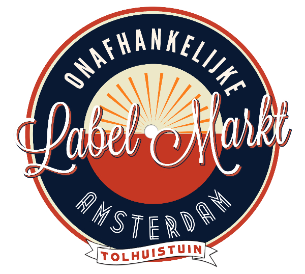

De Onafhankelijke Label Markt in de Tolhuistuin te Amsterdam Noord is dè plek waar zo genaamde independents hun producten ten toon spreiden en verkopen. De vierde editie vindt plaats op zondag 13 september.  
Waren het de voorbije jaren vooral platenmaatschappijen die zich op de misschien wel mooiste marktplaats van Nederland manifesteerden, op deze Vierde Onafhankelijke Labelmarkt zullen ook andere partijen hun kwaliteitsproduct etaleren. Zo zijn er klassieke fietsen, microbrouwerijen, strips, zeefdrukken, delicatessen en natuurlijk veel vinyl. Ook zullen koks uit Noord hun specialiteiten bereiden en is de bar geopend.

De organisatie van De Vierde Onafhankelijke Labelmarkt berust bij Excelsior Recordings (Independent Sinds 1996). Gastheer is Cultuur aan het IJ, de uitbater van het zo bloeiende creatieve complex aan de Noorderlijke boorden van het IJ.

Deelnemende partijen zijn onder andere de onafhankelijke platenlabels Beggars, Blowpipe, Excelsior Recordings, Geertruida, Goomah Music, Grey Past Records, Konkurrent, Paradiso Vinyl Club, Subroutine, Snowstar Records, Tender Records, Tonefloat Records en Zeal Records. Verder zijn ook Argibald, Heet op de Tong, Do You Know Flo & Ckoe, Hi Fi Klubben, Stadsbranderij Noord, Subbacultcha!, Nozzman, OOR, Record Industry, Velox Fietsen en Wiggle present in de Tolhuistuin.

De Vierde Onafhankelijke Labelmarkt is op zondag 13 september geopend van 12:30 tot 18:30 uur en is gratis toegankelijk.
