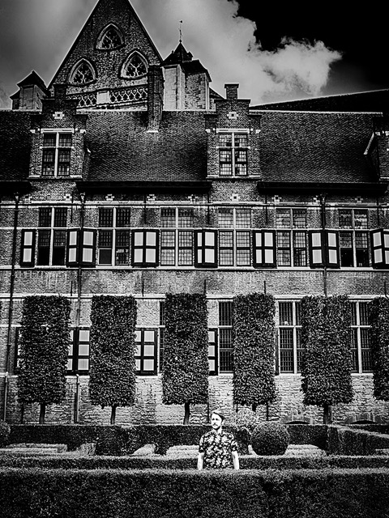

,Ik ben er een rijker mens door geworden’

Door Harry de Jong

Het legendarische album Graceland van Paul Simon staat centraal in het nieuwe theaterprogramma van de Vlaamse singer-songwriter Frederik Sioen. Begeleid door een groep muzikale vrienden uit Soweto voert hij de plaat integraal uit, maar dan wel op een heel eigenzinnige manier en aangevuld met eigen werk. De komende maanden is het kleurrijke muziekspektakel te zien in 20 Nederlandse theaters. Wij zochten Sieon alvast op in zijn woonplaats Gent.

Maar eerst even een geheugenopfrisser. Graceland van Paul Simon verscheen in 1986 en was zijn zevende studioplaat. Het was de eerste keer dat de Amerikaan experimenteerde met Afrikaanse muziek. Hij was geïnspireerd door een muziekcassette van de Boyoyo Boys. Simons muzikale aanpak was een groot succes, want van het album gingen miljoenen exemplaren over de toonbank.

**Niet toevallig**  
Het feit dat Sioen zijn tanden heeft gezet in Graceland, is niet toevallig. De Gentenaar was in 2007 al eens naar Johannesburg afgereisd om daar met plaatselijke muzikanten samen te werken. De klik met die lokale helden was groot en werd in 2009 beklonken met de release van het album Calling Up Soweto.

Photo © Henk Bleeker

,,Ik ben destijds naar Johannesburg afgereisd op initiatief van Oxfam Novib en de organisatie van De Gentse feesten,’’ vertelt Sioen op een terras aan de oevers van De Leie. Het in de zon glinsterende water splijt soepel golvend uiteen voor een passerende rondvaartboot. ,,Het was de bedoeling dat ik voor de Gentse Feesten een voorstelling zou maken met behulp van plaatselijke Zuid-Afrikaanse muzikanten. Dit omdat er in Johannesburg ook een Vlaams Cultuurhuis is gevestigd. Daar moest ik dan dat project opstarten. Ze hadden voor mij gekozen omdat ik bekend sta als een maatschappelijk geëngageerd iemand die ook nog eens graag muren tussen muziekculturen slecht. Dat project leek me een geweldige uitdaging. Ik heb een advertentie in de plaatselijke krant van Johannesburg geplaatst waarin ik muzikanten opriep voor een auditie. Er kwamen 33 zangers en zangeressen op af. Daar heb ik een goede selectie uit gemaakt. Die mannen en vrouwen hadden het bepaald niet breed, maar ze waren verschrikkelijk talentvol. Mijn mond viel van verbazing bijna open toen ik hen hoorde. We hebben samen met mijn eigen band een repertoire speciaal voor de Gentse Feesten ingestudeerd en dat werd een groot succes. De volgende twee jaar zijn we dan ook doorgegaan met het geven van concerten. Zowel in België als Zuid-Afrika. Prachtig, met zoveel verschillende nationaliteiten op reis in een busje. ‘’

Uiteindelijk werd besloten om gezamenlijk een album op te nemen en dat werd dus Calling Up Soweto. Saillant detail: de plaat werd gemaakt in dezelfde studio waarin Paul Simon zijn legendarische Graceland voor het nageslacht vastlegde. Toen het Festival van Vlaanderen in 2016 op het idee kwam om aandacht te besteden aan het 30-jarig bestaan van Paul Simons meesterwerk, was het dan ook niet meer dan logisch dat de organisatie aanklopte bij Frederik Sioen.

,,Ik moest er wel even een nachtje over slapen,’’ bekent de zanger. ,,Want het is niet niks, zo’n monumentale plaat even dunnetjes overdoen. Pas toen ik zelf met Afrikaanse muzikanten ging samenwerken, ontdekte ik de grootsheid en charme van Graceland. Die viel niet te evenaren. Maar ik ben toch de uitdaging aangegaan.’’

**Apartheid**  
Toen Paul Simon Graceland opnam, was er nog volop sprake van apartheid in Zuid-Afrika. Maar volgens Sioen is er sindsdien niet veel veranderd. ,,Bloemfontein is bijvoorbeeld bijna helemaal blank. Als ik daar met onze zwarte tourmanager over straat liep, werden we onverholen nagestaard. En als ik met hem in wilde checken bij een bed & breakfast, werden we ijskoud geweigerd. Ik ben de laatste jaren tien keer in Zuid-Afrika geweest en heb daardoor een goed beeld van de situatie gekregen. Blank en zwart wordt zoveel mogelijk gescheiden gehouden. Onze plaat Calling Up Soweto bleek daar zelfs moeilijk te verkopen omdat er zwarten en blanken op meespelen. Dat kregen we ijskoud van de distributeur te horen. Blanken spelen voor blanken en zwarten spelen voor zwarten, zo is het daar nog steeds. De criminaliteit is er ook hoog. Ik ben op tweede kerstdag in Johannesburg om drie uur ‘s middags zelfs bedreigd met een mes door twee mannen. Met bloeddoorlopen ogen keken ze me aan, duidelijk onder invloed van drugs. Ik moest mijn portemonnee afgeven, maar gelukkig kwamen er mensen aanlopen en toen gingen die overvallers er vandoor. En dat in een land waar je de mooiste natuur en wildparken ter wereld vindt. En waar je ook de meest gastvrije mensen ter wereld ontmoet. Maar ook een land waar ze je gewoon koelbloedig neerschieten als ze je auto willen stelen. In Soweto hoorde ik soms geweerschoten, dat verhoogt je gevoel van veiligheid niet. Toen ik op een middag het apartheidsmuseum in Johannesburg had bezocht, zag ik een paar straten verder een man in een cabriolet zitten met een blaffer in zijn hand. Doodleuk. Ik dacht eerst dat hij een sigaar in zijn hand had, maar toen zag ik dat het een revolver was. Ik was half in shock en ik dacht: moet ik hier een muziekproject opzetten? Zuid-Afrika is voor mij een land waar hemel en hel heel dicht bij elkaar liggen.’’

In een van de liedjes op Calling Up Soweto staat een nummer dat Robot heet. Sioen: ,,Dat gaat niet over een robot, maar over verkeerslichten. Die worden in Zuid-Afrika robots genoemd. Als het in Johannesburg ’s nachts stil is op straat, moet je niet stoppen voor rode lichten. Rij vooral door als er niemand aankomt, want de kans is groot dat je wordt beroofd.’’

**Gegroeid**  
Door al deze ervaringen is Sioen de laatste jaren flink gegroeid. ,,Alles aan mij is veranderd. Ook mijn stem. Een vriendin zei het al: als je naar Zuid-Afrika gaat, verander je helemaal. Je stem verandert omdat je hart verandert. Want je stem is het instrument dat het dichtst bij je persoonlijkheid staat. Op het podium presenteer ik me fysiek ook anders. Vroeger verschool ik me een beetje achter mijn piano, maar nu trek ik mijn schouders naar achteren en bloei ik op als persoon en muzikant. Ja, wat dat betreft heeft mijn muzikale reis door het leven me veel gebracht. En ik spiegel mij graag aan al die prachtige Afrikaanse muzikanten met wie ik werk. Door hen heb ik de waarde van het leven leren kennen. Hoe zij van dag tot dag binnen al hun beperktheden iets moois van hun leven proberen te maken, daar heb ik diep respect voor. Twee van onze zangers wonen nog steeds in hutten van golfplaten. Maar als je daar op bezoek komt, zorgen ze ervoor dat alles netjes is en ze maken zichzelf mooi van top tot teen. Ze hebben weinig toekomstbeeld, maar vergeten door de muziek heel gemakkelijk hun zorgen en stralen als ze zingen. Want ze weten van nature hoe ze moeten genieten van het leven. Ja, net als Paul Simon heb ik veel van mijn Afrikaanse avontuur geleerd. Ik ben er een rijker mens door geworden.’’

Foto’s: Henk Bleeker
