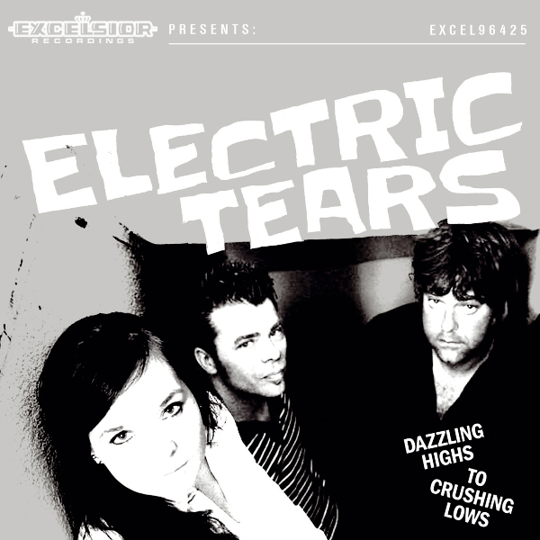

Na tien jaar in punkbandjes gespeeld te hebben vindt Niels de Wit het in 2011 wel weer eens tijd worden om zich van zijn melodieuze kant te laten horen. De Wit, bassist ten tijde van het debuutalbum van Johan, ronselt in zijn Hoornse stamcafé medebarzitter Bas de Vries alsmede bardame Els van Tol, en na vijf keer oefenen is daar het eerste optreden in datzelfde stamcafé, op de voet gevolgd door de zelf opgenomen single Bloodshed Eyes / Don’t Ask Me Why: twee keer twee minuten pakkende powerpop die menig neus hun kant op doen wijzen en vergelijkingen met Squeeze, Reigning Sound en Sandy Coast op doen borrelen.

Electric Tears speelt in 2013 op Noorderslag en Excelsior hangt aan de telefoon; of de heren en dame een elpee willen maken. Ze besluiten eerst iets anders te maken, namelijk kilometers. Na twee jaar het land doorkruist te hebben neemt de band, nu een goed geoliede rockmachine, in twee dagen haar debuut op in de studio van Frans Hagenaars. “Kan het wat zachter?” klinkt het vanuit het aanpalende Excelsior-kantoor waar de kopjes van de tafel trillen. Ja, het kan zachter – zoals de band laat horen in de ballades Forget Tomorrow en Blast Away – maar voor de rest is het weer hard, snel, kort en pakkend wat de klok slaat; twaalf nummers in 33:33. Half juni zal Dazzling Highs To Crushing Lows in de winkels liggen, en zullen Electric Tears weer het land op en neer gaan!

**Tourdata:**  
18 juni 2015 – SWAF, Hoorn (Albumpresentatie)  
19 juni 2015 – Pacific Parc, Amsterdam  
6 september 2015 – Zomerpop, Opmeer

<iframe src="https://www.youtube-nocookie.com/embed/02bSIeb8di0" title="Video" loading="lazy" allowfullscreen=""></iframe>

