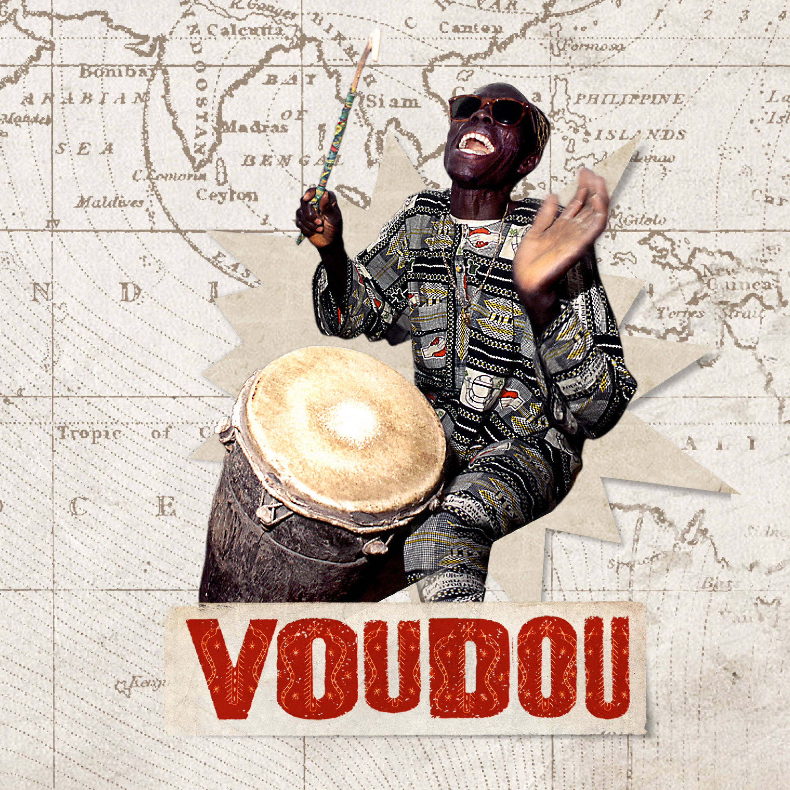

**Van Louis Armstrong en Lieve Hugo tot Ibeyi, Gil Scott-Heron en Orchestre Poly-Rythmo.**

**Voudou is een muzikale trip van New Orleans naar West-Afrika. Het geloof in voodoo heeft niets te maken met naalden en poppetjes, maar alles met een pantheon van goden die zichzelf alleen tonen als de juiste ritmes worden gespeeld. Op 18 april komt deze verontrustende compilatie uit via Excelsior Recordings. Negentien nummers van artiesten als Louis Armstrong en Lieve Hugo tot Kid Dynamite, Ibeyi en Orchestre Poly-Rythmo.**

Het album is de soundtrack bij het boek Voudou (publicatie 18 april 2017 via Atlas Contact), samengesteld door de auteur, muziekjournalist Leendert van der Valk. Boek en album laten zien dat voodoo van grote invloed is op moderne muziek. Van der Valk sprak met voodoopriesters en muzikanten in New Orleans, Haïti, Suriname, Togo en Benin en behandelt ook Cubaanse muziek.

Over de enorme invloed van voodoo op genres als jazz, blues, afrobeat, kaseko, rumba en salsa is weinig bekend omdat het niet past in het gangbare verhaal over popmuziek vanuit een voornamelijk wit perspectief. Maar er is een voodoo revival gaande onder jonge muzikanten wereldwijd. Op Voudou staan daarom naast obscure parels dan ook artiesten van wie je misschien nooit had verwacht dat ze een link met voodoo hebben. Voudou neemt je mee van oud naar nieuw, langs vier werelddelen, op een reis over de Atlantische Oceaan vol muzikale verrassingen.

<iframe src="https://www.youtube-nocookie.com/embed/6YG0VXBnmDA" title="Video" loading="lazy" allowfullscreen=""></iframe>

**Voudou – Various Artists**

1\. Voodoo Woman – Koko Taylor  
2\. Me and the Devil – Gil Scott-Heron  
3\. You’ve Got Me Voodoo’d – Louis Armstrong and His Orchestra  
4\. Ooh Na Nay – Cha Wa  
5\. Eleggua – Dr. John  
6\. Papa Loko (Se Van) – RAM  
7\. Neg Ayisien – Chouk Bwa Libète  
8\. Legba – Gardy Girault ft. James Germain  
9\. River – Ibeyi  
10\. Orisa – Gilles Peterson’s Havana Cultura Band ft. Dreiser & Sexto Sentido  
11\. Kodokoe Loekoe Boeng – Lieve Hugo  
12\. Wientie Groove (part 1) – Oscar Harris & the Twinkle Stars  
13\. De Winti-Dansi – Kid Dynamite, De Bonanza Boys, Lou Hidalgo  
14\. Kobi Lolo – Togo All Stars  
15\. Pas Contente – Vaudou Game ft. Roger Damawuzan  
16\. Vodoo Sakpata – Elom 20ce  
17\. Yoruba – Gangbé Brass Band ft. Femi Kuti  
18\. Heritage – Orchestre Poly-Rythmo
