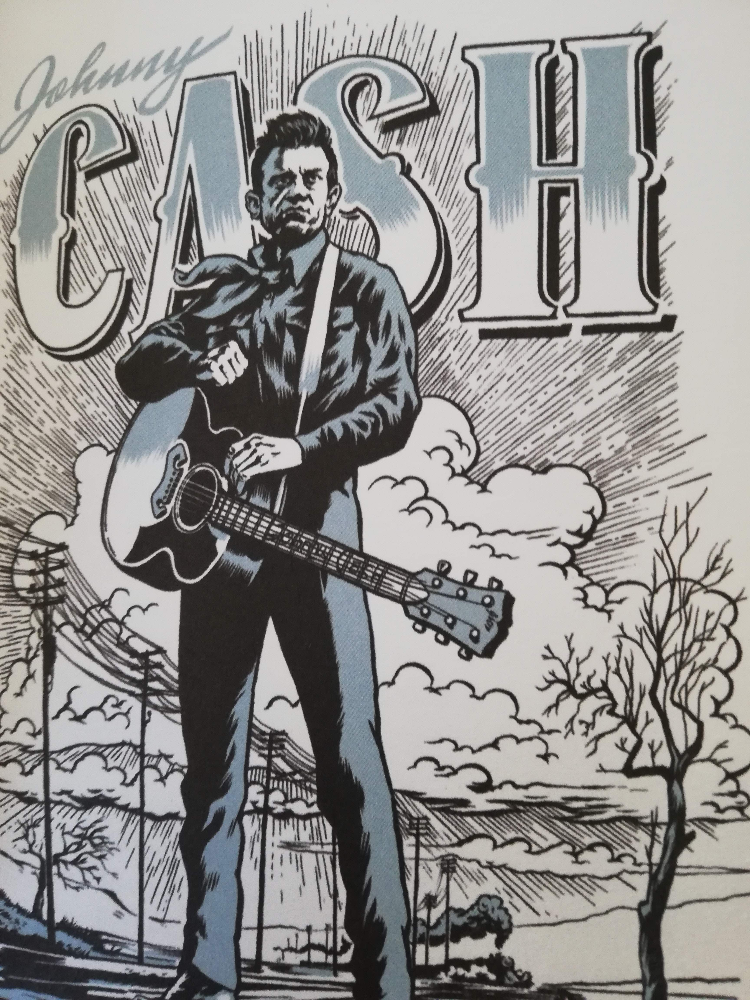

Door Harry de Jong

Welcome To Creek Country. Dat is de titel van een fraai  120 pagina’s tellend boekwerk dat onlangs  verscheen bij Concertobooks in Amsterdam. Het telt op de kop af 50 tekeningen van helden uit de wereld van de Amerikaanse folk, bluegrass en countrymuziek. Auteur is de Amsterdamse striptekenaar Erik Kriek. Met deze portretten brengt hij naar eigen zeggen ,, een getekende hommage aan al die artiesten wiens muziek mij door de jaren heen hebben geïnspireerd en die mijn werk aan de tekentafel hebben veraangenaamd.’’

En dan hebben we het over artiesten als Johnny Cash, Hank Williams, Stanley Brothers, Lefty Frizzell,  Webb Pierce, Patsy Cline, Flatt & Scruggs en Bill Monroe. De grondleggers uit de jaren veertig en vijftig van moderne country en bluegrass, zeg maar.  Maar ook oldtimers als Dock Boggs, Charlie Poole en de Carter Family komen aan bod, net als folkpioniers als Pete Seeger en Woody Guthrie. Verder maakt Kriek ook nog even een uitstapje naar artiesten als Guy Clark en Townes Van Zandt, een generatie singer-songwriters die zich in de jaren zeventig van de vorige eeuw parallel ontwikkelde naast de outlaw stroming in de countrymuziek. Van die stroming was Willie Nelson het boegbeeld en die ontbreekt uiteraard ook niet in dit boek. Mooi, karaktervol getekend. Elk portret gaat overigens vergezeld van een korte biografie met enkele essentiële gegevens en leuke weetjes over de betreffende artiest.

Maar daarmee is de koek nog niet op. Bij het boek is een cd gevoegd waarop Tim Knol en the Bluegrass Boogiemen 15 liedjes laten horen van de artiesten uit dit boek. Speciale gasten hierbij zijn Margot Merah en Sophie Janna van the Lasses. Ook Erik Kriek doet als zanger even een duit in het zakje. Het klinkt allemaal lekker authentiek.

Zelf zegt Kriek over dit project:  *,,Tekenen in het algemeen en strips maken in het bijzonder is een vrij eenzame bezigheid. Uren en uren worden in eenzaamheid achter de tekentafel doorgebracht. Alles voor de juiste concentratie. En niks gaat vanzelf. Het werk is immers pas af als het ‘af’ is, ongeacht hoe lang dat duurt. Vanzelfsprekend is muziek daarbij de beste vriend van de tekenaar en door middel van muziek wordt de arbeid lichter. Ik ken geen enkele tekenaar die niet van muziek houdt, sterker nog:  veel van mijn collega-tekenaars zijn ook muzikant en als ze geen instrument beheersen dan hebben ze een uitgebreide platenkast en ditto smaak. Veel van hen hebben een voorliefde voor country. Misschien is het het eerlijke, ambachtelijke aspect ervan. Ik persoonlijk houd erg van het instrumentarium en van de stemmen, vooral de close-harmony die vaak te horen is in de bluegrass. Ook ben ik liefhebber van verhalende songteksten, recht voor zijn raap en vaak bestaande uit gecomprimeerde tragedies. Vooral die teksten die zich bezighouden met duistere thema’s spreken me aan. Ik heb er al een keer een heel (strip)boek aan gewijd. Creek Country is een heel arbitraire verzameling van een liefhebber, niet per sé van een muziekhistoricus of kenner. Het zijn er 50 omdat dat een mooi rond getal is, niet omdat ik een top vijftig met de beste artiesten heb willen maken.  Het gevaar bij het maken van een dergelijk boek is dat er de indruk ontstaat dat er een zekere pikorde is, maar geloof me, ik vul met gemak nog twee of drie van dit soort boeken. Er valt nog zoveel te ontdekken uit het ‘mer à boire’ dat de muziekgeschiedenis ons geeft. Dat is weer stof voor een mogelijk volgend boekje. Wie zal het zeggen?’’*

Welcome To Creek Country Boek en CD verscheen bij Concertobooks en kost 29,90.
