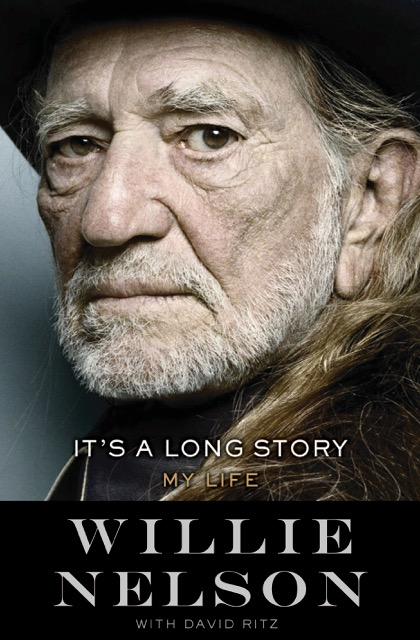

Willie Nelson  
My Life (It’s A Long Story)  
ISBN: 978-0-7515-6547-8  
Sphere

Simpel en doeltreffend: dat zijn de liedjes van countryzanger Willie Nelson. En dat is ook zijn met behulp van David Litz geschreven kloeke autobiografie My Life (It’s A Long Story). Eenvoudig taalgebruik zorgt ervoor dat dit boek heel gemakkelijk wegleest. Willie’s levensmissie is vanaf zijn kleutertijd duidelijk: liedjes schrijven en die aan zoveel mogelijk mensen laten horen. Nu hij 83 is, heeft de muze hem nog steeds niet in de steek gelaten: Hij maakt nog altijd albums en treedt wekelijks op, hoewel hij steeds vaker af moet zeggen in verband met kwaaltjes. Niemand zingt zoals Willie Nelson en hij is door de jaren heen een oorspronkelijk talent gebleven. Het heeft mij dan ook altijd verbaasd dat hij zich in de jaren zestig zo heeft laten inpakken door Chet Atkins. Acht jaar lang stond hij onder contract bij RCA en bij elke nieuwe elpee wist Atkins als producer de liedjes om zeep te helpen door ze te laten verzuipen in een overdaad aan strijkers en zoemkoortjes. In My Life bekent Nelson dat hij zich aan het lijntje liet houden omdat Atkins misschien wel eens voor de grote doorbraak zou kunnen zorgen. Maar dat gebeurde niet. Die doorbraak kwam pas toen Nelson Nashville voor Austin verruilde, het recht in eigen had nam en met z’n eigen band z’n zelf geschreven liedjes op ging nemen. Aan het begin van de jaren zeventig sloeg hij daarmee een brug tussen hippies en rednecks en was z’n kostje gekocht. De impact op de countrywereld was destijds zo groot, dat Nelson er vandaag de dag nog z’n status aan ontleent. De meerwaarde van dit boek zit ‘m vooral in het feit dat je nu voor het eerst alle achtergronden krijgt te horen van de manier waarop hij destijds Austin veroverde.

Harry de Jong
